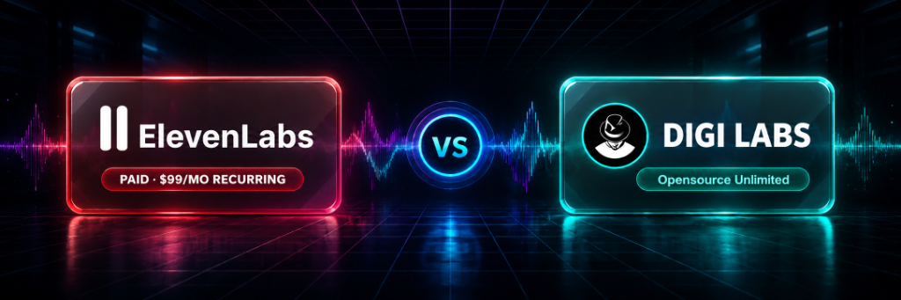
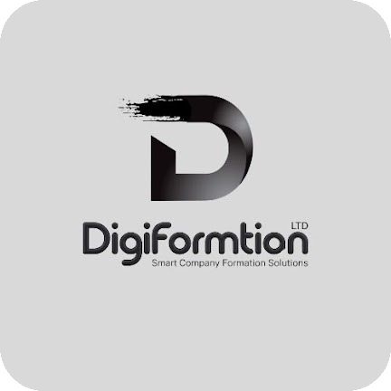

<p align="center">
  
</p>

# DIGI LABS — Unlimited Free Human TTS & Video-to-Prompt Studio
### The Sovereign Open-Source ElevenLabs Alternative & Media Reverse-Engineering Engine

<p align="center">
  <a href="https://www.digibizos.co.uk/open-source/digi-labs">
    
  </a>
  <a href="https://www.digibizos.co.uk/open-source/digi-labs">
    
  </a>
</p>

> [!TIP]
> 📥 **Direct Windows Installer Setup (.exe 253MB):**  
> Standalone Windows setup file and instant downloads are hosted on our official DIGI BIZ OS portal:  
> 👉 **[https://www.digibizos.co.uk/open-source/digi-labs](https://www.digibizos.co.uk/open-source/digi-labs)**

DIGI LABS is a standalone, ultra-realistic desktop voice and media intelligence workstation created by DigiFormation Ltd. It delivers human-grade voice synthesis (Gemini 2.5 Flash Voice & Edge-TTS) with zero monthly fees, alongside a revolutionary **Video-to-Prompt & Course Extraction Engine**.

---

## 🚀 Key Highlights & Capabilities

### 1. Dual Audio Synthesis Engines (Zero-Cost ElevenLabs Alternative)
- **Studio Voice (Gemini 2.5 Flash)**: Ultra-expressive, nuanced, breathing human voice with emotion and multi-key auto-rotation.
- **Free Voice (Edge-TTS)**: 100% Unlimited long-form audiobook and narration engine with zero API key requirement.
- **Multilingual Excellence**: Native English, Urdu (with RTL Nastaliq toggle), Hindi, and Arabic vocal presets.

### 2. Video-to-Prompt & Course Engine (Reverse-Engineer Any Video)
- **Turn Any Video Link into an AI Prompt**: Paste any YouTube/MP4 link to extract the exact cinematic prompt, camera direction, lighting, and scene structure to regenerate with Sora, Runway Gen-3, Kling, or Midjourney.
- **Instant Course Generator**: Convert 1-hour lectures into modular, structured step-by-step masterclasses.
- **Executive Study Guides & Notes**: Extract actionable takeaways, checklists, and executive summaries from any video.
- **Word-for-Word Transcription**: Local Whisper-powered speech-to-text with timestamped accuracy.

### 3. Desktop Workstation (Windows 10 & 11 Native)
- Built on high-performance Electron + Express + Node.js backend with local FFmpeg media processing.
- Clean dark-mode interface with job queues and real-time generation progress.

---

## 🛠️ Quick Start & Installation

```bash
# Clone the repository
git clone https://github.com/digiformationltd-creator/DIGI-LABS-FREE-TTS-TRANSCRIPT-.git
cd DIGI-LABS-FREE-TTS-TRANSCRIPT-

# Install dependencies
npm install

# Option A: Run the Studio Server (Web UI on http://127.0.0.1:4300)
npm run server

# Option B: Launch the Native Desktop Workstation
npm start

# Option C: Build the Windows NSIS Installer (.exe)
npm run dist
```

---

## 🔑 Multi-Key Rotation System (Never Run Out of Quota)

Add multiple free Gemini API keys in Settings. DIGI LABS automatically balances and rotates through up to 9 key slots:

```env
GEMINI_TTS_KEY
GEMINI_OPENCODE_KEY
GEMINI_UTILITY_KEY
GEMINI_API_KEY_1 ... GEMINI_API_KEY_5
GEMINI_API_KEY
```

When one key reaches its daily rate limit, DIGI LABS seamlessly shifts to the next key without failing your audio generation.

---

## 📦 System Requirements

- **OS**: Windows 10 / 11 (64-bit), macOS, or Linux
- **Runtime**: Node.js 18+ & Python 3.10+
- **Media Engine**: FFmpeg (for clip joining and format transcoding)

---

## 🛡️ License, Terms & Strict Resale Prohibition

Published under the **DIGIFORMATION LTD Source-Available & Studio License** (Apache 2.0 / MIT Core Engine).

- ✅ **100% Free For Your Own System**: Free forever for your personal PC, agency workstation, and content creation workflow. Generate unlimited client audiobooks, podcasts, videos, and prompts. Keep 100% of your commercial client earnings.
- ❌ **STRICTLY NO RESELLING**: Reselling this software, selling modified binaries, white-labeling, or re-hosting it as a paid commercial cloud SaaS is strictly prohibited. Exactly like DIGI LEAD HUNTER, this software is open-source/source-available exclusively for direct use on your own local machines.

---

## 🏢 Corporate Provenance & Leadership

<div align="center">
  <table>
    <tr>
      <td align="center" width="200" valign="middle">
        <a href="https://www.digiformation.co.uk/">
          
        </a>
        <br /><br />
        <strong>DIGIFORMATION LTD</strong>
        <br />
        <sub>Company # 16994903</sub>
      </td>
      <td valign="middle">
        <strong>DIGI LABS</strong> is engineered and open-sourced by <strong>DIGIFORMATION LTD</strong> — a registered UK corporate entity providing agentic AI architecture and sovereign digital infrastructure.
        <br /><br />
        🌐 <strong>Corporate Website:</strong> <a href="https://www.digiformation.co.uk/">https://www.digiformation.co.uk/</a><br />
        🏢 <strong>UK Company Registry:</strong> Company # 16994903 (England & Wales)<br />
        💬 <strong>WhatsApp Hotline:</strong> <a href="https://wa.me/923164467464">+92 316 4467464 (03164467464)</a><br />
        📧 <strong>Official Email:</strong> <a href="mailto:info@digiformation.co.uk">info@digiformation.co.uk</a><br />
        📺 <strong>YouTube Channel:</strong> <a href="https://www.youtube.com/@Digiformationltd">@Digiformationltd</a><br />
        🌳 <strong>All Verified Links:</strong> <a href="https://linktr.ee/digiformationltd">linktr.ee/digiformationltd</a>
      </td>
    </tr>
  </table>
</div>

---

## 📞 Official Contact & Support Directory

- **Primary WhatsApp Support Hotline:** [+92 316 4467464 (03164467464)](https://wa.me/923164467464?text=Hello%20DIGIFORMATION%20LTD%2C%20I%20am%20using%20DIGI%20LABS)
- **Official Corporate Emails:** [info@digiformation.co.uk](mailto:info@digiformation.co.uk) • [info@digibizos.co.uk](mailto:info@digibizos.co.uk)
- **Companies House UK Registry:** [Company # 16994903 (Official UK Government Registry)](https://find-and-update.company-information.service.gov.uk/company/16994903)
- **DIGIFORMATION LTD Corporate Website:** [https://www.digiformation.co.uk/](https://www.digiformation.co.uk/)
- **Digi Biz OS Ecosystem:** [https://www.digibizos.co.uk/](https://www.digibizos.co.uk/)
- **Official Linktree (All Verified Channels):** [https://linktr.ee/digiformationltd](https://linktr.ee/digiformationltd)

© 2026 DIGIFORMATION LTD. All Rights Reserved. Registered in England & Wales (Company # 16994903).


